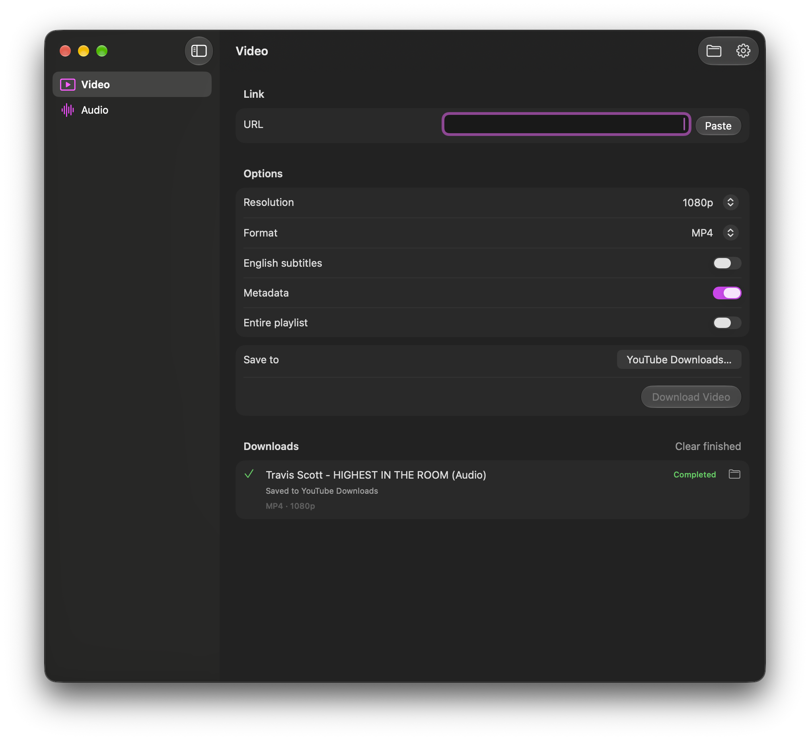

# Savior

[](LICENSE)

A native macOS 26+ SwiftUI wrapper for yt-dlp. Video and Audio have independent options, with a shared serial download queue and saved history.

- Video: preferred resolution, automatic/MP4/MKV container, available English subtitles, metadata, and playlists.
- Audio: M4A, MP3, FLAC, WAV, or Opus; quality selection; metadata and playlists.
- Folder selection, live progress, cancellation, retries, Finder reveal, and download logs (right-click a download).
- Native Liquid Glass sidebar and controls, semantic colors, keyboard shortcuts, and system light/dark appearance.



## Run

Install tools with `brew install yt-dlp ffmpeg`, open `Savior.xcodeproj`, and run the Savior scheme. Homebrew paths on Apple Silicon and Intel Macs are detected automatically. Settings can select other executables. The app is configured without App Sandbox so it can execute locally installed command-line tools and write downloads to the selected folder.

Downloads default to `~/Downloads/Savior`. Preferences and queue history are stored in UserDefaults. Interrupted downloads can be retried; yt-dlp resumes existing partial files when supported. Resolution is a preferred maximum and remains subject to what the source provides. Audio transcoding cannot improve source quality. Site authentication and browser-cookie import are not currently exposed.

## Verify

```sh
xcodebuild -project Savior.xcodeproj -scheme Savior -configuration Debug -destination 'platform=macOS,arch=arm64' CODE_SIGNING_ALLOWED=NO build
Tests/run-smoke-tests.sh
python3 Tests/run-integration-tests.py
```

The smoke tests use isolated preferences and temporary executable fixtures to verify URL validation, serial queue behavior, UTF-8 output, error handling, running/queued cancellation, retries, and persistence. Integration tests additionally require yt-dlp and FFmpeg at `/opt/homebrew/bin`; they generate a one-second clip, serve it locally, and verify actual MP4 and M4A output. All test media is temporary.

## Design references

The interface uses native navigation and glass button styles, keeping the options and download list on quiet content surfaces, following [Apple’s Liquid Glass guidance](https://developer.apple.com/documentation/technologyoverviews/adopting-liquid-glass) and [custom SwiftUI glass documentation](https://developer.apple.com/documentation/swiftui/applying-liquid-glass-to-custom-views). Downloader arguments follow the [yt-dlp documentation](https://github.com/yt-dlp/yt-dlp#usage-and-options).


## Contributing

Issues and pull requests are welcome. Describe the change, include reproduction steps for bugs, and run the verification commands above before submitting code. Contributions are licensed under the MIT license.

## License

Savior’s source code, original artwork, and documentation are free and open source under the [MIT license](LICENSE). You may use, study, modify, and redistribute them, including commercially, under its terms.

Savior uses Apple’s macOS frameworks and requires macOS to run. [yt-dlp](https://github.com/yt-dlp/yt-dlp) and [FFmpeg](https://ffmpeg.org/) are installed separately and retain their own licenses; they are not bundled in this repository. The screenshot illustrates the app interface and does not include downloaded media.
